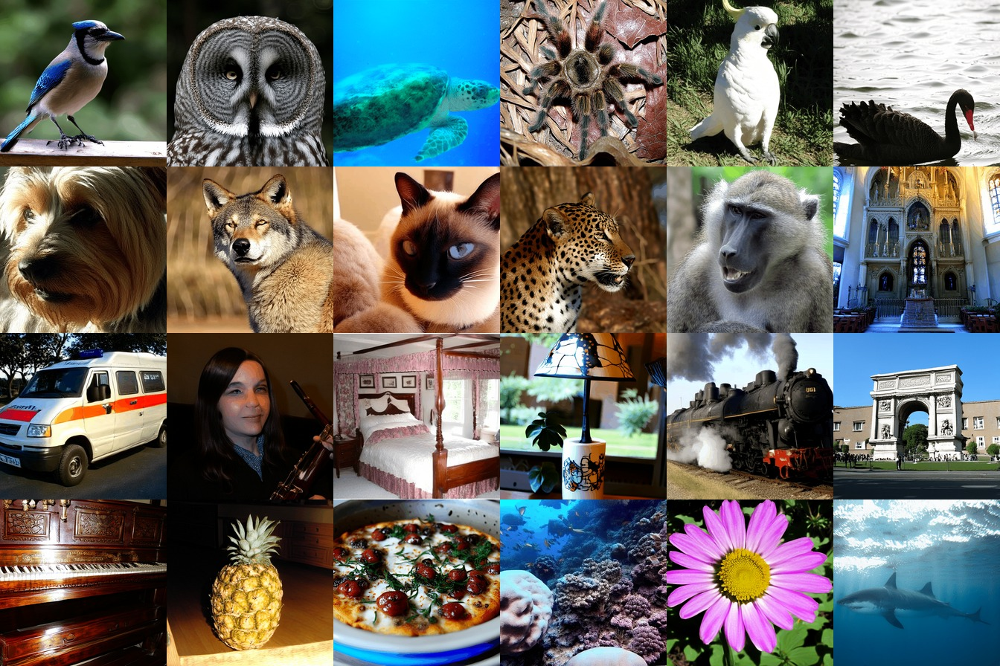
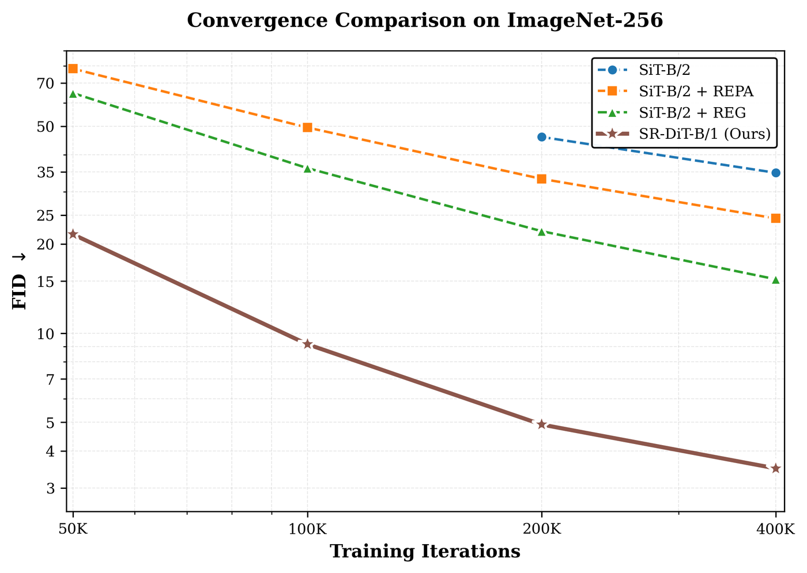

I'm Swayam Bhanded, a research engineer at [Luma Labs AI](https://lumalabs.ai/). My work focuses on making diffusion models more efficient to train and run.

## Research

I'm the author of [Speedrunning ImageNet Diffusion](https://arxiv.org/abs/2512.12386) (arXiv 2512.12386), which introduces **SR-DiT** (Speedrun Diffusion Transformer) — a framework that combines a bunch of training techniques to achieve a ~360x training speedup on ImageNet-256. Getting 3.14 FID with only a 140M parameter model, rivaling models 5x its size whilst training for significantly fewer iterations.

<figure>
  
  <figcaption>Figure 1: SR-DiT-B/1 samples on ImageNet-512.</figcaption>
</figure>

<figure>
  
  <figcaption>Figure 2: Training convergence comparison on ImageNet-256. SR-DiT-B/1 achieves strong performance with substantial convergence speedup.</figcaption>
</figure>

You can see other projects on my [GitHub](https://github.com/SwayStar123/).

I also post thoughts about research on [X](https://x.com/SwayStar123).

## Blockchain

I previously worked at [Fuel Labs](https://fuel.network), where I was a contributor to the [Sway](https://github.com/FuelLabs/sway) smart contract language

## Other

I made this [AI animated version of Bad Apple](https://www.youtube.com/watch?v=D7oc1Axl1h0) a while ago.

It didnt get much views on youtube or X, but managed to get millions of views when reposted by people on chinese social media.

I speak Japanese, and am learning Chinese.
